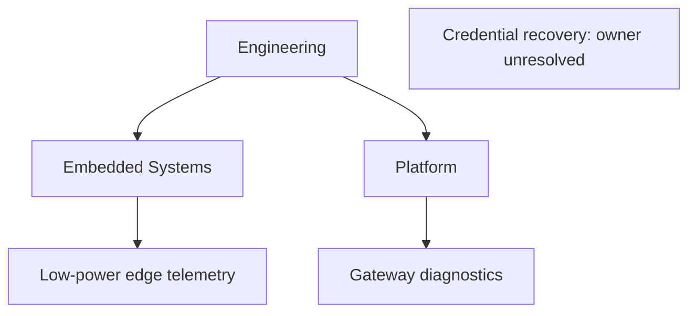

# Fictional strategy review

As of November 2, 2026. Scope: a five-record internal extract, not a complete company portfolio. The 180-day review window is an arbitrary example policy. All source references below refer to `sources.md`. Calculated detail is in `expected-output.json`.

## Technology and ownership map

| Bucket | Products | Responsible team/contact | Confirmed records | Known family labels | Open disclosures |
| --- | --- | --- | ---: | ---: | ---: |
| Low-power edge telemetry | Sensor | Embedded Systems / Mira | 2 | 1 | 1 |
| Gateway diagnostics | Gateway | Platform / Theo | 2 | 2 | 0 |
| Device credential recovery | Sensor and gateway | Unassigned | 0 | 0 | 0 |

Engineering is the parent of Embedded Systems and Platform. Contact associations are not inventorship determinations. R31-US is proposed for credential recovery and excluded from confirmed mapping counts. [ORG-01 §1] [MAP-01 §1]

Organization and bucket relationships from [ORG-01 §1] and [MAP-01 §1].

## Portfolio inventory

Five application-level internal records, three known family labels, and one record with unknown family. F17 has US and EP records and is counted once globally. Supplied statuses are two pending, one issued, one expired, and one abandoned. All public identifiers are missing, so the example reports zero known publication identifiers rather than asserting no applications were published. [PORT-01 §1]

## Feature and jurisdiction review

| Target | Jurisdiction | Inventory signal | Known active families / business target | Recorded review and next action |
| --- | --- | --- | --- | --- |
| Urgent-alert batching | US | Pending candidates only | 1 / 2 | One open disclosure; seek technical/claim review. |
| Scheduling expansion | EP | Pending candidates only | 1 / 1 | Count target met; feature protection remains unassessed. |
| Gateway timing diagnostics | US | Issued candidates require claim review | 1 / 1 | Supplied supports assessment retained, but current result withheld because status evidence is stale. |
| Credential recovery | US | No confirmed mapped records | 0 / 1 | Current recorded gap assessment applies only to the limited extract; proposed abandoned record needs mapping review. |

The apparent US batching and credential count shortfalls are business planning signals, not instructions to file one application each. Meeting a count target likewise does not establish useful feature coverage. [ROAD-01 §1]

For diagnostics, the fictional October 20 review is within-window, but R25-US status is dated January 1, 2025. Refresh that evidence before treating the supplied support result as current under this policy. The stale review path does not turn support into a gap. [PORT-01 §1] [REVIEW-01 §1]

For credentials, the October 20 gap assessment is preserved with the stated limited scope; software has not independently established the conclusion. R31-US is proposed-only, abandoned, and undated. No company-wide absence of coverage or freedom-to-operate conclusion follows. [REVIEW-01 §2] [PORT-01 §1]

D01 is in review and counts as an open disclosure. D02 is marked filed, so it is retained for reconciliation but not counted as open or added to application counts. [PIPE-01 §1]

## Handoff to filing review

The generated `filing_review_context` contains compatible bucket and portfolio records plus the current recorded T-SEC gap. It excludes stale/non-gap assessments from the gap list. This context is a partial handoff; review scope and source dates must accompany it. Existing invention gap references need reconciliation before merging into an older filing-review file.

## Actions

1. Strategy owner: assign credential-recovery ownership and review the proposed mapping.
2. Portfolio administrator: refresh R25-US/R31-US status evidence and resolve missing public identifiers/family metadata.
3. Counsel: review target-specific claims, source completeness, and the scope of the recorded gap assessment.
4. Inventors and counsel: develop D01 and clarify its technical contribution; reconcile D02 with the actual application record.
5. Budget owner: use confirmed priorities in the filing-review scenarios with actual costs; no automatic filing quota or deferral is authorized.
